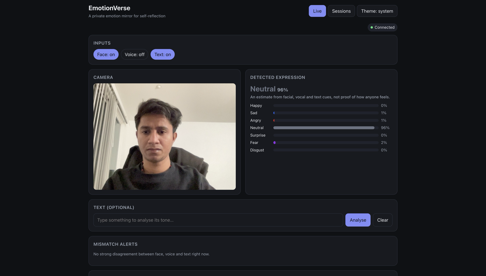
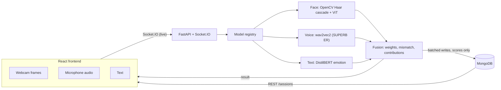

# EmotionVerse

[](https://github.com/asadmulani5/Emotionverse/actions/workflows/ci.yml)

**A private, explainable, multimodal emotion mirror.** EmotionVerse reads the expression shown by your **face**, **voice** and **words** in real time, fuses them into one reading, explains how each input contributed, and flags moments when the signals disagree (for example, a smiling face with a tense voice).

It is a personal self-reflection tool. It runs entirely on your own machine, and it stores only emotion scores, never images, audio or text.



## Features

- **Three inputs, one reading:** facial expression (webcam), speech tone (microphone) and text, each switchable on or off.
- **Fusion engine:** weighted combination of whichever inputs are available, re-balanced automatically when one is off or fails.
- **Mismatch alerts:** highlights when two inputs confidently disagree, treating disagreement as an insight rather than noise.
- **Explainability panel:** shows how much each input contributed to the top detected expression.
- **Session history:** every reading is saved with a timestamp; review a session's summary (dominant expression, average mix, spikes) and replay it with play/pause, a slider and 1x/2x/4x speed.
- **Privacy first:** consent screen before anything is captured; only scores are stored.
- **Resilient backend:** a model that fails to load or crashes is isolated and the rest keep working; inputs are validated; frames are dropped rather than queued when the server is busy; `/health` reports model and database status.

## Architecture



| Input | Model | Output labels |
|---|---|---|
| Face | Haar cascade face detection + [`trpakov/vit-face-expression`](https://huggingface.co/trpakov/vit-face-expression) | 7 expressions |
| Voice | [`superb/wav2vec2-base-superb-er`](https://huggingface.co/superb/wav2vec2-base-superb-er) | neutral, happy, angry, sad |
| Text | [`bhadresh-savani/distilbert-base-uncased-emotion`](https://huggingface.co/bhadresh-savani/distilbert-base-uncased-emotion) | 6 emotions |

All labels are mapped to one canonical set (happy, sad, angry, neutral, surprise, fear, disgust) before fusion.

**Stack:** Python 3.12, FastAPI, python-socketio, PyTorch, Hugging Face Transformers, OpenCV, MongoDB, React 19, Chart.js, Docker, GitHub Actions.

## Quick start (Docker)

Requires [Docker Desktop](https://www.docker.com/products/docker-desktop/).

```bash
git clone https://github.com/asadmulani5/Emotionverse.git
cd Emotionverse
docker compose up --build
```

Open <http://localhost:3000>. The first start downloads the three models (about 1 GB), so allow a few minutes. The backend needs about 1.25 GB of RAM.

## Local development

**Backend** (Python 3.12):

```bash
python3.12 -m venv venv
venv/bin/pip install torch==2.2.2 --index-url https://download.pytorch.org/whl/cpu
venv/bin/pip install -r backend/requirements.txt -r backend/requirements-dev.txt

# MongoDB for session history (optional: the app runs without it)
docker run -d --name emotionverse-mongo -p 27017:27017 -v emotionverse-mongo-data:/data/db mongo:7

cd backend
../venv/bin/python -m uvicorn main:socket_app --port 8000
```

**Frontend** (Node 20+):

```bash
cd frontend
npm install
npm start
```

Open <http://localhost:3000>.

## Configuration

Settings live in [`backend/config.yaml`](backend/config.yaml): fusion weights, mismatch threshold, input limits, timeouts, database batching and summary thresholds.

| Environment variable | Purpose | Default |
|---|---|---|
| `MONGO_URI` | MongoDB connection string | `mongodb://localhost:27017` |
| `CORS_ORIGINS` | Comma-separated allowed frontend origins | `http://localhost:3000` |
| `DISABLED_MODELS` | Comma-separated models to skip (`face`, `voice`, `text`) | none |
| `VOICE_MODEL` | Hugging Face id of the voice model | `superb/wav2vec2-base-superb-er` |
| `EMOTIONVERSE_DB_ENABLED` | Set to `0` to turn off persistence | enabled |
| `PORT` | Backend port inside the container | `8000` |
| `REACT_APP_BACKEND_URL` | Backend URL baked into the frontend build | `http://localhost:8000` |

Secrets go in a git-ignored `.env` file (see `.env.example`), never in code.

## API

| Method | Path | Description |
|---|---|---|
| Socket.IO | `analyze` → `emotion_result` | Live analysis of a frame, audio clip and/or text |
| `GET` | `/health` | Model, database and memory status |
| `POST` | `/predict/face`, `/predict/voice`, `/predict/text` | Single-input prediction |
| `GET` | `/sessions` | List saved sessions |
| `GET` | `/sessions/{id}` | One session's results and summary |

## Testing

```bash
# Backend: 77 tests
cd backend && ../venv/bin/python -m pytest -q

# Frontend: 18 tests
cd frontend && CI=true npm test -- --watchAll=false
```

CI runs backend tests, frontend tests with a production build, and a gitleaks secret scan on every pull request. All three must pass before merging to `main`. A pre-commit hook also blocks commits containing secrets.

## Privacy, ethics and limitations

- **Detected expressions are estimates, not feelings.** A smile is not proof of happiness. The app says "detected expression" on purpose.
- **For personal use only.** Do not use it to monitor employees, students or anyone who hasn't agreed. Emotion recognition in workplaces and education is prohibited under the EU AI Act.
- **What is stored:** emotion scores and timestamps only. Frames, audio and text are analysed in memory and discarded.
- **Hosted vs local:** running locally keeps everything on your machine. A hosted deployment sends inputs to its server.
- **No user accounts yet:** anyone who can reach the backend can list saved sessions. Fine for local use; a public multi-user deployment would need authentication.
- **Model limits:** the voice model distinguishes only four classes, was trained on acted English speech and often reads excited speech as angry (both are high-energy). The text model is English only. Expression datasets carry demographic and cultural biases, and accuracy drops with poor lighting or unusual angles.

## Project structure

```
backend/
  main.py            FastAPI + Socket.IO app and REST routes
  registry.py        Model loading, failure isolation, timeouts
  fusion.py          Weighted fusion, mismatch detection, contributions
  summary.py         Session summary and spike detection
  db.py              MongoDB persistence with batched background writes
  validation.py      Input validation
  models/            Face, voice and text model wrappers
  tests/             pytest suite
frontend/src/
  pages/             Live and Sessions pages
  components/        Panels, alerts, replay, consent screen
  hooks/             Socket.IO connection with auto-reconnect
.github/workflows/   CI pipeline
docker-compose.yml   One-command local run
DEVLOG.md            What was built, why, and key concepts
```

## Roadmap

- Hosted demo (frontend on Vercel, backend on Hugging Face Spaces)
- User accounts so sessions are private per user
- UI polish and mobile layout
- Session export (CSV/JSON)

## Author

**Asad Mulani** · [GitHub](https://github.com/asadmulani5)
